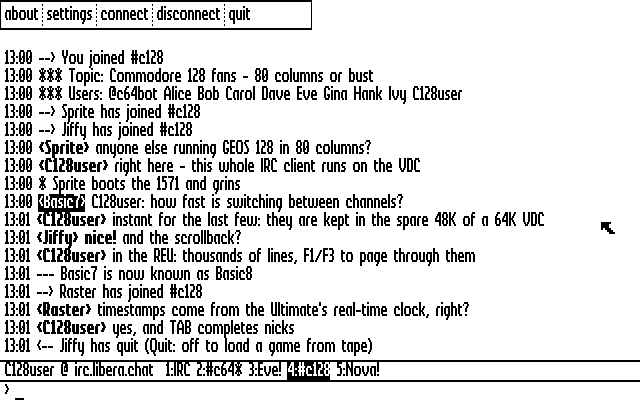

# geoChat 128

An IRC client for **GEOS 128 in 80 columns**, for a Commodore 128 with an **Ultimate 1541 II+** cartridge, which
provides the network connection. Several channels and private chats at once, fast 80-column text, and scrollback
that lives in your REU.



## Highlights

- **Several channels and private chats at once.** Up to 8 windows (the server window plus 7 channels or private
  chats) shown as tabs on the status line. Switch with F5/F7, a click on a tab, or `/win n`. A private message
  opens its own window. Tabs show `*` for unread and `!` when someone mentions you.
- **Instant window switching with a 64 KB VDC** (C128DCR, or an upgraded C128). geoChat 128 detects the extra video
  RAM at start-up and keeps the last three windows you left there, so switching back to them takes about 0.1 s.
- **Fast 80-column text.** geoChat 128 draws text with its own routine instead of GEOS's: lines appear about 4 times
  faster, and they look exactly like GEOS text.
- **Scrollback in the REU.** Thousands of lines per session when an REU is enabled (the Ultimate can provide
  one); without an REU, 32 KB of the C128's second RAM bank (about 1,400 lines). F1/F3 page back and forward.
- **Network and clock from the Ultimate.** Connects through the Ultimate's Command Interface, over Ethernet or
  Wi-Fi. The timestamps come from the Ultimate's real-time clock.
- **Stays connected.** Reconnects by itself and rejoins your channels when the connection drops, including a
  pulled network cable (which reports nothing: geoChat 128 notices the silence).
- **Starts the way you like.** Open it from the GEOS 128 deskTop, or make a boot disk that starts GEOS straight
  into geoChat 128.

## Also

- Timestamps on every line; your own nick highlighted when someone mentions you, with a short audible "ding"
  from the SID chip (also for private messages).
- Joins, parts and kicks appear in their channel. Quits and nick changes don't name a channel on IRC, so
  geoChat 128 shows them in each window where that person has been seen, and in your private chat with them.
- mIRC **bold** and reverse shown; colour codes removed; UTF-8 characters shown as `?`.
- Line editing with cursor left/right, input history (cursor up/down), and TAB nick completion (it remembers about
  75 nicks, the people who spoke or joined most recently first).
- While you are scrolled back, new messages don't move the page; the status line says `[new below: ESC]`, and
  pressing ESC takes you back to the newest messages.
- Connection messages (connecting, the server's welcome, errors) go to the IRC window, as in irssi; the window
  you are reading only gets what belongs there.
- Answers CTCP VERSION, PING, TIME and CLIENTINFO.
- Settings on one page (nick, channel, server, port), saved to a GEOS file on the disk. To join several channels
  when you connect, list them in the settings' channel field, separated by commas: `#c64friends,#c128`.
- When connecting fails because the Ultimate has no network address, it says so ("cable? Wi-Fi?").
- Tab names get shorter as windows open, so all 8 tabs always fit on the 640-pixel line.

## Requirements

- A **Commodore 128** with an 80-column monitor. A 64 KB VDC (C128DCR or upgraded) is optional: it enables
  instant window switching.
- **GEOS 128 2.0.** geoChat 128 does not include GEOS; use your own system disk.
- An **Ultimate 1541 II+** with the **Command Interface** enabled and a network connection (Ethernet or Wi-Fi).
  - Tested on the Altera version (firmware 3.14d) over Ethernet.
  - Wi-Fi on the Ultimate 1541 II+L (the Lattice version) should work too, but hasn't been tested yet.
- **Optional:** the Ultimate 1541 II+'s built-in REU (RAM Expansion Unit), for a larger scrollback buffer.
- A **mouse or joystick in port 1**: see [Mouse or joystick](#mouse-or-joystick).

## Getting started

The [`target`](target) folder (and each [release](https://github.com/djcarlin/geochat128/releases/latest))
has geoChat 128 on its own as a disk image for each drive type: `geochat128.d64` (1541),
`geochat128.d71` (1571) and `geochat128.d81` (1581). Use the one that matches a drive your GEOS is set up for,
in the Ultimate or written to a real disk; the `.d64` also works in a 1571. For making a boot disk there are
`geochat128-boot.cvt` (also in `target`) and `mkboot.sh`, `c128boot.py` and `d64refs.py` (also in `tools`).

**From the deskTop.** Open the disk, copy "geoChat 128" to your GEOS 128 disk if you like, and double-click it.

**A boot disk that starts straight into geoChat 128.** From your own GEOS 128 2.0 system disk image (needs VICE's
`c1541` and Python 3):

```
./mkboot.sh GEOS128.D64 geochat128-boot.cvt mouse my-geochat128.d64        # or: joystick
```

Then, with the **40/80 key down**, switch on or reset the C128 with that disk in drive 8.

**First time:** choose **settings**, set your nick (the channel defaults to #c64friends), OK, then **connect**.

On the Ultimate: enable the Command Interface (and the REU, if you want REU scrollback) in its menu. Put the
disk on the SD card or USB stick: a disk image uploaded over the network lives in `/Temp` and loses your saved
settings when another disk is mounted.

## Mouse or joystick

geoChat 128 doesn't care which pointing device you use; it uses GEOS's own input driver, which reads port 1.

- **Started from the deskTop:** geoChat 128 uses whatever input driver your GEOS is already running, the one the
  deskTop installed at start-up. A 1351 mouse, a joystick, or any other GEOS 128 input driver works, and
  nothing needs setting up in geoChat 128. Adapters that act like a 1351 (for example a MouSTer for USB mice) work
  the same way.
- **The boot disk** (`mkboot.sh`) has no deskTop to install a driver, so geoChat 128 loads it itself: the first
  GEOS 128 input driver on the disk. That's why `mkboot.sh` asks for `mouse` or `joystick` and removes the
  other driver from the copy it makes. To switch later, make the disk again with the other choice.
- With a joystick, the fire button clicks. The keyboard does most things anyway: F5/F7 switch windows and
  `/win n` jumps to one.

## Keys and commands

| Keys | |
|---|---|
| F1 / F3 | page back / forward |
| ESC | back to the newest messages |
| F5 / F7 | previous / next window |
| cursor left / right | move in the input line |
| cursor up / down | input history |
| TAB | complete a nick |
| DEL | delete the character before the cursor |
| CLR/HOME | clear the input line |

`/join #chan` `/part [msg]` `/close` `/query nick [text]` `/msg nick text` `/me action` `/notice nick text`
`/nick name` `/topic [text]` `/names` `/whois nick` `/away [msg]` `/win n` `/clear` `/raw line` `/quit [msg]`
`/help`

## Known limitations

- No TLS: geoChat 128 connects without encryption (port 6667).
- At most 8 windows; messages for a 9th channel or chat go to the IRC window.
- No nick list pane, no DCC, no colours.

## Building from source

Needs cc65 2.19 (`cl65`, `grc65`), VICE 3.x (`x128`, `c1541`), Python 3, and your own GEOS 128 2.0 system disk
image: `make GEOS128=path/to/GEOS128.D64 ...`, or put `GEOS128 = path/to/GEOS128.D64` in `local.mk`.

```
make                          # build/geochat128.cvt + build/geochat128.d64
make NICK=you boot            # build/geochat128-boot.d64: boots straight into geoChat 128 (1351 mouse)
make NICK=you boot-joy        # the same for a joystick
make NICK=you desk            # build/geochat128-desk.d64: normal GEOS 128 with geoChat 128 on the disk
make test                     # the self-test (below), with a 16 KB VDC and with a 64 KB VDC + 512 KB REU
make screenshot               # docs/geochat128.png
make release                  # build/release/: the files of a release; also updates target/
```

For testing on a real network, build with `CHAN='#yourtestchannel'` so connect and reconnect tests don't
disturb a real channel.

### The self-test

`make test` runs geoChat 128 in VICE without a window and checks everything it can: about 150 numbered checks
covering the IRC session, the settings page and file, all windows and tabs, scrollback, the message store
(2,000 messages, with and without an REU), history and nick completion, routing of joins/quits/nick changes,
CTCP, reconnecting (including a pulled cable), the 64 KB VDC cache, and the fast text drawing, which must match
GEOS's own `PutString` pixel for pixel. It prints `PASS` or `FAIL n: what went wrong`.

How it works: a test build replaces the network driver with a "mailbox" (a buffer in memory that the test reads and
writes in place of the network) and adds a small agent. `tools/vtest.py`
boots it in `x128`, talks to VICE's binary monitor, plays the IRC server itself, types and clicks through GEOS's
own input variables, and checks the program's variables (by name, from the linker's label file) and the screen
(by reading VDC memory). The result goes to `$D7FF`, which makes VICE exit with that code. Its options and
the other tools are described in [tools/README.md](tools/README.md).

## How it works

- **C** (cc65, `geos-cbm` target) for the logic; **assembly** for the hardware: VDC scrolling, block copy and
  fill, the fast text routine, and GEOS 128's back-RAM moves.
- **Message store** (`src/store.c`): one ring for all windows, in the REU or back RAM. Each record links to the
  previous record of its window, so a window's history is walked back quickly however busy the others are. The
  screen is always drawn from the store.
- **Fast text** (`src/fastdraw.s`, `src/fastline.c`): GEOS draws an 80-column character by rewriting each of its
  pixel rows through the VDC, about 5,000 cycles per character. geoChat 128 builds a whole text line in RAM and
  sends it to the VDC in one stream after clearing the line with the VDC's block fill. Its glyphs are sampled at
  start-up from what GEOS itself draws, so the text is identical.
- **Window cache** (`src/ui.c`, `src/hw.s`): with a 64 KB VDC, VDC RAM at $4000, $8000 and $C000 holds the
  message area of the last windows you left; coming back is a VDC block copy. A cached window is dropped as soon
  as it gets a new message, so it is never shown out of date.
- **Memory:** besides the usual application area, geoChat 128 uses GEOS 128's 80-column background-screen buffer
  ($6000-$7F3F and $A040-$BF7F) for code and buffers. It redraws its own screen after menus and dialogs, so GEOS
  never needs that buffer.

Reading the code: start with `src/main.c` (start-up, menus, keys), then `src/ui.c` (the screen) and `src/irc.c`
(the protocol), then `src/store.c` (the message store). The assembly is in `src/fastdraw.s` and `src/hw.s` (ca65);
everything else is C. Each file starts with a comment saying what it does.

| File | What |
|---|---|
| `src/main.c` | menus, the about box, GEOS processes, keyboard/mouse dispatch, input driver loading (boot disk) |
| `src/ui.c` | windows, tabs, drawing from the store, word wrap, scrolling, scrollback, history, completion, cache |
| `src/store.c` | the message ring (REU or back RAM) |
| `src/irc.c` | IRC protocol: parsing, routing, numerics, CTCP, commands, reconnect, keepalive |
| `src/settings.c` | the settings page and file |
| `src/net_uci.c` | the Ultimate Command Interface network driver |
| `src/fastdraw.s`, `src/fastline.c` | fast text lines and their glyph cache |
| `src/hw.s` | VDC scroll, copy, size detection, back-RAM moves, the test result |
| `src/geochat128.cfg` | linker configuration |
| `src/agent.c`, `src/net_mbox.c`, `src/mbox.h`, `src/res-test.grc` | test builds: the agent and the mailbox network (`res-test.grc` is also the boot-disk build's header) |
| `tools/vtest.py`, `tools/vicemon.py`, `tools/vtest.sh` | the self-test |
| `tools/mkboot.sh`, `tools/c128boot.py`, `tools/d64refs.py` | making the boot disk; the C128 boot sector |
| `tools/seticon.py` | the deskTop icon |

## How it was made

geoChat 128 was written with Claude, Anthropic's AI assistant, and directed and tested on a real Commodore 128
with an Ultimate 1541 II+ and a 64 KB VDC.

## Licence

MIT: see [LICENSE](LICENSE).
